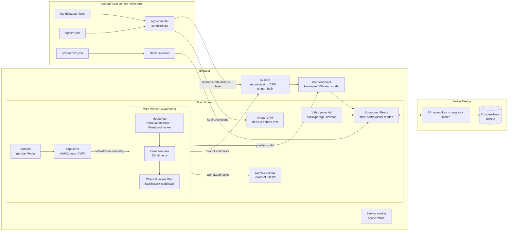

# Arsitektur Lakon

## Prinsip

1. Main thread tidak pernah memproses frame; seluruh computer vision berjalan di Web Worker.
2. Data 30 fps tidak pernah melewati state React; overlay digambar ke canvas lewat ref.
3. Satu sumber kebenaran: animasi avatar dan referensi verifikasi dikompilasi
   dari spesifikasi parametrik yang sama.
4. Tidak ada frame video yang keluar dari perangkat.

## Diagram alur data

## Susunan paket

| Paket / direktori        | Isi                                                                                                                        | Aturan                                          |
| ------------------------ | -------------------------------------------------------------------------------------------------------------------------- | ----------------------------------------------- |
| `packages/sign-schema`   | Skema Zod + enum tertutup + validator konten                                                                               | Murni, tanpa DOM                                |
| `packages/sign-compiler` | Spesifikasi → keyframe (IK lengan, SLERP, lintasan, simetri, kontak) → referensi DTW; sumbu engsel dipakai bersama M2/M4   | Murni, tanpa DOM (three hanya untuk matematika) |
| `packages/cv-core`       | frameFeatures 134 dimensi, DTW terperinci, segmentasi, umpan balik, fusi stabilisasi + klasifikasi                         | Murni, tanpa DOM                                |
| `apps/web/workers`       | cv.worker: MediaPipe + fitur + ONNX                                                                                        | Satu-satunya tempat yang menangani frame        |
| `apps/web/features`      | avatar (penyelesai rotasi, pemutar), practice (pipeline, overlay, verifikasi), scenario (mesin), progress, collect, editor | Logika tanpa komponen React                     |
| `apps/web/components`    | Layar dan blok UI                                                                                                          | Tanpa logika CV                                 |
| `content/`               | handshapes, signs, scenarios (JSON, derajat, kebab-case)                                                                   | Gerbang build `review.status`                   |
| `training/`              | PyTorch → ONNX; featurisasi Python mencerminkan cv-core                                                                    | Laporan akurasi per kontributor                 |
| `tools/`                 | validator, seed, fetch-assets, audit aksesibilitas                                                                         | Node, dipakai skrip build                       |

## Keputusan utama

- **Penyelesai rotasi (M2)** bekerja pada rig humanoid ter-normalisasi milik
  three-vrm, sehingga sumbu engsel jari menjadi konstanta lintas-rig;
  kompiler (M4) memakai konstanta yang sama — satu sumber kebenaran untuk
  geometri.
- **Referensi verifikasi** dihitung dalam satu lintasan dengan keyframe avatar,
  lewat kinematika maju pada kerangka avatar yang terukur, dan dilewatkan ke
  `frameFeatures` yang sama dengan saat runtime; tidak ada jalur kedua.
- **Lulus bila minimal 40% mirip contoh**: skor DTW tiap isyarat dikalibrasi
  terhadap landmark video peraga (`content/peraga-landmarks/`, diekstrak
  `tools/extract-peraga.mjs`). 100% berarti semirip video penanda, 0% berarti
  sejauh median isyarat lain. Hasil kalibrasi adalah snapshot uji
  (`features/practice/calibration.json`); bila spesifikasi isyarat berubah,
  uji gagal sampai diperbarui dengan `pnpm vitest -u`.
- **Model klasifikasi di balik sakelar**: `NEXT_PUBLIC_PAKAI_MODEL=1` membuat
  praktik memuat `public/models/classifier.json` dan lulus hanya bila model
  minimal 80% yakin. Tanpa sakelar, atau bila model gagal dimuat, praktik
  memakai aturan kemiripan. Data latih awal dibuat dari rekaman peraga
  (`pnpm exec tsx tools/peraga-to-training.ts`), satu penanda saja, sehingga
  model belum layak dinyalakan sebelum ada rekaman dari banyak orang lewat
  `/tools/collect`.
- **Aset MediaPipe di-host sendiri** (`tools/fetch-assets.mjs` → `public/`)
  sehingga importScripts tidak bergantung pada CDN, service worker
  menyimpannya di cache, dan latihan tetap jalan offline.
- **Progres langsung ke database**: progres isyarat, checkpoint, dan
  jalannya skenario dikirim ke API dan disimpan di Postgres. Permintaan yang
  gagal (offline) diantrekan di memori dan dikirim ulang begitu daring
  kembali; tidak ada salinan lokal.
- **Peragaan manusia sebagai bawaan**: isyarat dengan `media.video` memutar
  video penanda (`pnpm peraga` memproses `content/BISINDO/`); avatar 3D tetap
  tersedia lewat tombol alih dan untuk tampak kanan/kiri. Verifikasi tetap
  memakai referensi yang dikompilasi dari spesifikasi parametrik.
- **Layar besar**: mulai 1800px ukuran font root membesar bertahap
  (`--skala-layar`), sehingga tata letak berbasis rem ikut menskala; peta
  perjalanan membaca skala yang sama untuk geometri SVG-nya.
